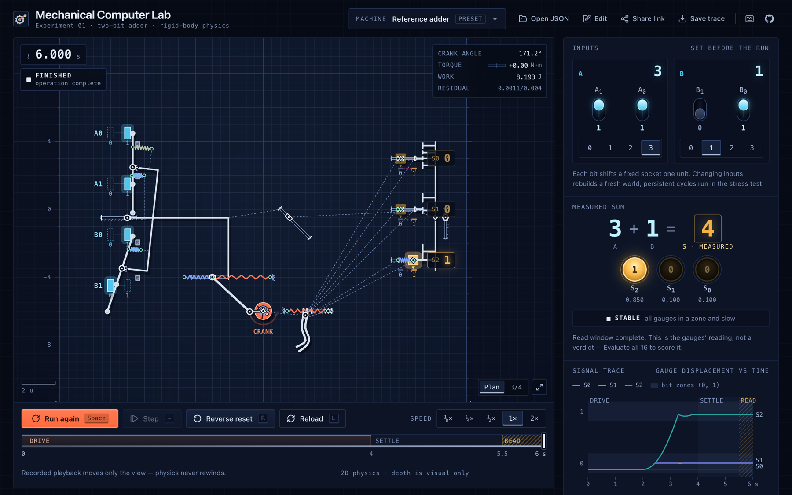
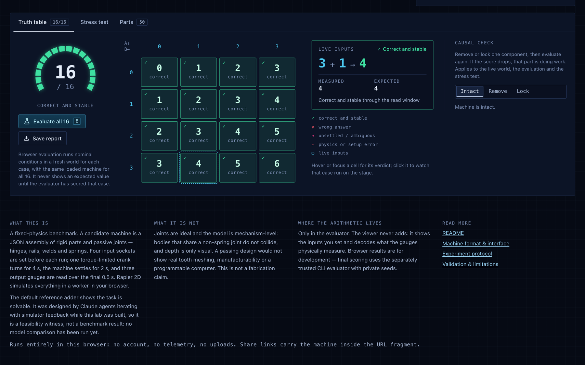

# Mechanical Computer Lab

**Can a model design a machine that adds?** This is a fixed-physics benchmark for **two-bit mechanical adders**: a candidate is a JSON assembly of rigid parts and passive joints (hinges, rails, welds, springs). Four input sockets are set, one torque-limited crank turns for 4 seconds, and three output gauges must physically settle on the binary sum `A + B`. Rapier simulates the mechanics, a separate evaluator scores all 16 input pairs, and a Three.js workbench lets you watch every part move.

[**Open the lab →**](https://kiankyars.github.io/mechanical-computer-lab/) · runs entirely in your browser: no account, no telemetry, no uploads.



## Status

- **The task is solvable.** [`machines/reference-adder.machine.json`](machines/reference-adder.machine.json) is a crank-driven adder that scores **16/16** and passes the development stress profile (perturbed drive speed, torque, friction and input offset; half timestep; persistent worlds with reverse-crank resets) and 11 further seeds. Lock its crank and it computes nothing. See [validation](docs/validation.md).
- **The benchmark is not yet run.** No one-attempt-versus-feedback model comparison has been performed, and the task's difficulty for models is uncalibrated. The reference adder was designed by Claude agents with simulator feedback during development. [Withhold it from participant workspaces](docs/experiment.md#reference-solution-and-contamination).
- The slider-crank fixture is a physics positive control (it moves but does not add); the empty starter scores 1/16 (only `0 + 0`).

## How the reference adder computes



1. **Sum by displacement.** The crank drives a carriage that pushes a sum bar through a clutch spring. A whiffletree (two 2:1 rockers averaged by a third) ends in four knobs that stop against the input blocks, so the sum bar comes to rest at `x₀ + (A + B)/6`. The carry is literally an addition of displacements.
2. **Code bar.** An inclined slot turns that travel into the height of a code bar beside the gauges. Each of its seven levels presents a tooth (bit 0) or a gap (bit 1) to each output's nub.
3. **Clocked probe.** Near the end of the stroke a pin on the crank enters a curved channel and drives a probe slider. Springs push each output toward the code bar: a tooth stops it at 0.10, a gap lets it run to 0.85. The crank then parks just past a dead centre, so nothing is back-driven once the torque stops.
4. **Reset.** Turning the crank backwards pulls the outputs home, withdraws the sum bar and squares the rockers against a fixed comb.

It is regenerated by `npx tsx tools/reference-adder.ts` (every anchor derives from named parameters). 18 bodies, 32 joints, 3.3 J initial spring energy (mostly a clutch preload held against a stop); the crank supplies about 8 J per operation.

## Start

Node 22.13+ and npm are required. Dependencies and Rapier are pinned in `package-lock.json`.

```sh
npm ci
npm run check
npm run dev
```

Open [the local workbench](http://127.0.0.1:3018). It opens on the reference adder and turns the crank once. From there:

- **Watch** — set the bit switches, turn the crank, pause and single-step, change speed, scrub the recorded timeline (playback never writes back into physics), pan/zoom or tilt to a 3/4 view, and hover any part for its live state. Hinges, rails, welds and springs are all drawn, and gauges glow in their 1 zone.
- **Test** — evaluate all 16 pairs into a live truth table, run the in-browser development stress profile, or remove/lock a component to see whether the score depends on it.
- **Build** — open a machine JSON, edit it with live schema validation, and share it: a share link carries the whole machine inside the URL fragment.

Press `?` for keyboard shortcuts. There is no account, cloud compute, telemetry, or paid model API in this experiment.

## GitHub Pages

Pushes to `main` validate the frozen protocol, build the same viewer as a static site, and deploy it through GitHub Actions. The simulation runs locally in your browser's worker; machine uploads are not sent to a server. Final experiment scoring still uses the separately trusted CLI evaluator.

The workbench is a plain Vite + React single-page app (`app/`, built into `dist/`). To preview the published build locally:

```sh
BASE_PATH=/mechanical-computer-lab/ npm run build
BASE_PATH=/mechanical-computer-lab/ npm run preview   # http://127.0.0.1:3018/mechanical-computer-lab/
```

Stop `npm run dev` first (both use port 3018). Set the same `BASE_PATH` for both commands: preview serves `dist/` under that base, and without it the Pages build's asset URLs fall through to `index.html` and the page stays blank. Without `BASE_PATH`, `npm run build` targets the site root and `npm run preview` serves it at http://127.0.0.1:3018/.

## Evaluate a design

Edit a copy of `machines/starter.machine.json`, not the simulator or evaluator.

```sh
npm run evaluate -- --machine machines/starter.machine.json
npm run evaluate -- --machine machines/starter.machine.json --profile development --seeds 17,29
npm run trace -- --machine machines/starter.machine.json --a 3 --b 1
npm run evaluate -- --machine machines/physics-fixture.machine.json --remove connecting-rod
```

Reports and traces go into ignored `results/`, with unique filenames and no overwriting. Each CLI report includes the candidate, evaluator, and dependency-lock hashes, runtime/platform, trial conditions, failures, gauge measurements, work, and constraint diagnostics. Add `--require-pass` for a nonzero exit code on an unsuccessful machine. Ordinary evaluation exits successfully when it has produced a valid report, even if the candidate fails.

The development profile covers nominal conditions, two reproducible perturbation seeds, a half-timestep numerical audit, and **both fresh and persistent worlds**. Persistent cycles use reverse-crank reset and retain internal/output state. Input setting remains an external setup action, not a physically modeled actuator. `Reload` in the viewer is explicitly not a mechanical reset.

## Experiment boundary

| Candidate controls                                             | Experiment controls                                             |
| -------------------------------------------------------------- | --------------------------------------------------------------- |
| Part geometry, constant starting pose, fixed/dynamic body type | Rapier version, timestep, material settings and validity checks |
| Passive hinges, rails, fixed joints and bounded springs        | Four input sockets, three output gauges and decoding thresholds |
| Which proposed carry components to identify                    | One fixed, torque-limited crank schedule and final scoring      |

No executable candidate code, kinematic parts, participant motors, gear-ratio constraints, callbacks, custom output mappings, or task-conditioned internal initialization. Input fixtures allow **contact coupling only**, avoiding work injected through inconsistent input-joint anchors. Excess initial overlap, broken constraints, excessive spring preload, ambiguous flags and numerical failure all fail closed.

This is a **mechanism-level** benchmark: joints are ideal, and collisions between directly non-spring-jointed bodies are disabled. All other candidate interactions use contact geometry. A passing machine would not by itself demonstrate real tooth meshing, manufacturability, or a programmable computer.

## Repository

```text
simulator/       frozen schema, fixtures, drive, mechanics and gauge decoding
evaluator/       arithmetic oracle, fixed run schedule, scoring and perturbations
scripts/         evaluation, traces, provenance and freeze verification
machines/        starter, physics fixture and reference adder
tools/           reference-adder generator (not part of the frozen protocol)
viewer/          read-only Three.js renderer and physics-worker adapter
app/             workbench interface (Vite + React)
tests/           physics controls, adversarial evaluator tests, reference adder
docs/            machine format, experiment protocol, validation
protocol.lock.json  hashes of the frozen experiment implementation
```

- [Machine format and physical interface](docs/machine-format.md)
- [One-attempt versus feedback experiment](docs/experiment.md)
- [Validation and limitations](docs/validation.md)

`npm run verify:frozen` detects accidental drift. It is **not a security boundary against an agent that can edit the whole checkout**. Final evaluation must run the submitted JSON in a separately trusted copy whose evaluator hash was recorded before optimization. Never update the protocol lock to make a candidate pass.

## Sources

[Rapier rigid bodies](https://rapier.rs/docs/user_guides/javascript/rigid_bodies/), [joints](https://rapier.rs/docs/user_guides/javascript/joints/), [determinism](https://rapier.rs/docs/user_guides/javascript/determinism/), and [Three.js](https://threejs.org/docs/). The engine performs general rigid-body dynamics; the addition oracle appears only in the evaluator.
